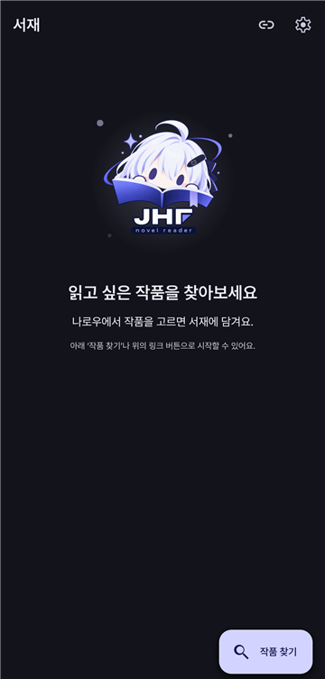
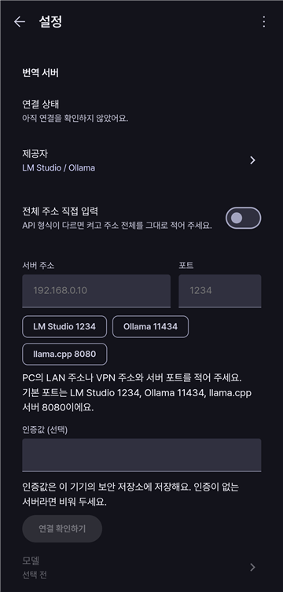

  <picture>
    
  </picture>

  <h1>JHF Novel Reader</h1>
  
내 PC의 로컬 AI로 일본 웹소설을 번역해, 휴대폰에서 쾌적하게 읽는 Android 앱

[![Release][release-shield]][release-url]
[![Android][android-shield]][release-url]
[![License: MIT][license-shield]][license-url]
[![Checks][checks-shield]][checks-url]

  <a href="#처음-쓰기">처음 쓰기</a> &middot;
  <a href="#주요-기능">주요 기능</a> &middot;
  <a href="#개인정보와-연결">개인정보와 연결</a> &middot;
  <a href="https://github.com/earlydreamer/jhf-novel-reader/releases">다운로드</a>

---

  
  &nbsp;&nbsp;
  

## 왜 만들었나요

일본 웹소설을 번역해 읽는 방법에는 저마다 제약이 있어요.

- 대부분의 번역 앱은 Gemini 같은 AI 서비스의 API 키가 필요하고, 쓰는 만큼 비용이 생겨요.
- 브라우저에 내장된 구글 번역은 번역 품질이 아쉬워요.
- 파파고 같은 웹 번역기는 무료 사용량에 제한이 있어요.

JHF Novel Reader는 **내 컴퓨터의 로컬 모델**로 번역해서 이런 제약을 넘고, 작품을 쾌적하게 감상하는 것을 목표로 해요.

## 주요 기능

- **내 PC의 로컬 모델로 번역** — PC에 OpenAI 호환 API로 띄운 서버에 휴대폰이 직접 연결해요. LM Studio·Ollama·llama.cpp는 프리셋이 준비돼 있어요.
- **앱 안에서 찾고 바로 읽기** — 나로우 사이트를 앱 안에서 둘러보거나 작품 주소를 붙여 넣어 작품을 고르고, 회차를 누르면 번역이 시작돼요. OpenAI 호환 서버로 번역할 때는 도착한 문단부터 보여 줘요.
- **번역한 회차는 다시 번역하지 않아요** — 끝까지 번역한 회차는 휴대폰에 저장돼요. 다시 열면 저장본이 바로 열리고, 서버에 연결하지 않아도 읽을 수 있어요.
- **미리 번역** — 범위나 전체 회차를 순서대로 번역해 둬요. 이미 같은 설정으로 번역한 회차는 건너뛰어요.
- **작품별 용어집** — 등장인물·지명 표기를 작품마다 정해 두고 번역에 적용해요.
  - 번역 전에 새 이름을 모아 용어집을 자동으로 만들어요.
  - 정밀스캔으로 저장한 회차 전체를 다시 살펴 표기를 다듬어요. 위키백과·나무위키 조회는 켜고 끌 수 있어요.
  - 읽는 화면에서 용어를 강조해 보여 주고, 길게 눌러 바로 추가·편집·삭제해요.
  - 원하면 판정 모델(약 165MB)을 내려받아 켜면, 휴대폰 안에서만 돌면서 애매한 이름이 그 용어인지 문맥으로 가려요.
- **번역 확인과 다시 번역** — 일본어가 남은 문단과 용어집 표기가 빠진 문단을 알려 줘요. OpenAI 호환 서버로 번역할 때는 문단만 골라 다시 번역할 수 있어요.
- **읽기 화면** — 글자 크기, 줄 간격, 독서 배경(기본·세피아·검정), 다크 테마, 원문 보기를 지원하고 읽던 위치를 기억해요. 회차 제목과 작품 제목도 번역해요.
- **백업과 복원** — 서재·저장한 번역·용어집·읽기 위치·설정을 파일 하나로 저장하고, 새로 설치한 앱에서 되살려요.

## 준비물

| 무엇 | 설명 |
|---|---|
| Android 휴대폰 | Android 7.0 이상, 64비트(arm64) |
| 번역 서버 | OpenAI 호환 API를 제공하는 PC. LM Studio, Ollama, llama.cpp 등으로 모델을 띄워요. 휴대폰에서 접속할 수 있는 주소면 되고, 같은 Wi‑Fi에 없어도 돼요. |
| 번역 모델 | 일본어→한국어 번역이 되는 모델이면 돼요. Gemma 4 E4B로 실제 사용을 확인했어요. |

## 처음 쓰기

1. [릴리스 페이지][release-url]에서 최신 APK를 받아 설치해요. 처음이면 ‘출처를 알 수 없는 앱 설치’를 허용해야 해요.
2. PC에서 번역 서버를 켜고 모델을 불러와요. 다른 기기에서 접속할 수 있게 열어 두세요.
3. 앱의 **설정 → 번역 서버**에 PC 주소와 포트를 넣어요. `LM Studio 1234`·`Ollama 11434`·`llama.cpp 8080` 버튼으로 포트를 채울 수 있어요.
4. **연결 확인하기**를 누르고 번역에 쓸 모델을 골라요.
5. 서재의 **작품 찾기**에서 작품을 열고 회차를 누르면 번역이 시작돼요.

## 앱 구성

| 화면 | 하는 일 |
|---|---|
| 서재 | 담아 둔 작품과 이어서 읽기 |
| 작품 찾기 | 나로우 사이트를 앱 안에서 둘러보고 작품을 서재에 담기 |
| 작품 | 회차 목록과 저장 상태, 용어집 편집·용어 정밀스캔·미리 번역·제목 번역 |
| 리더 | 번역 읽기, 보기 설정, 원문 보기, 번역 확인, 문단 다시 번역, 용어 강조·편집 |
| 설정 | 번역 서버와 모델, 번역 방식, 용어 정밀스캔·판정, 테마, 백업 |

## 개인정보와 연결

번역한 회차, 원문, 용어집, 읽기 위치는 휴대폰의 앱 전용 저장소에만 있어요. 서버 인증값은 휴대폰의 보안 저장소에 따로 보관해요. 앱 개발자가 운영하는 서버는 없어요.

앱이 연결하는 곳은 다음이 전부예요.

| 연결 | 언제 | 보내는 것 |
|---|---|---|
| 나로우 | 작품을 찾고 회차를 열 때 | 페이지 요청 |
| 내 번역 서버 | 번역할 때 | 회차 원문과 번역 지시 |
| 위키백과·위키데이터 | 정밀스캔 조회를 켰을 때만 | 용어 이름 |
| 나무위키 | 정밀스캔 조회를 켰을 때만 | 용어 이름 |
| Hugging Face | 판정 모델을 내려받을 때만 | 모델 파일 요청 |

## 이전 버전(0.1.x)에서 옮기기

0.1.x는 다른 앱으로 설치돼 있어서 데이터가 자동으로 넘어오지 않아요.

1. 이전 앱을 0.1.27로 업데이트하고 **설정 → 백업 파일 만들기**로 파일을 저장해요.
2. 새 앱의 **설정 → 백업에서 복원하기**에서 그 파일을 골라요.
3. 서버 인증값과 판정 모델은 백업에 들어가지 않아요. 필요하면 다시 넣거나 내려받아요.

## 알아 두세요

- 번역 품질은 사용하는 모델에 따라 달라요. 앱은 남은 일본어와 빠진 용어 표기를 찾아 주지만, 뜻이 맞는지는 판단하지 못해요.
- 공개된 회차만 읽어요. 로그인이나 연령 확인이 필요한 회차는 열지 않아요.
- 번역 결과는 개인 감상용이에요. 원문과 번역을 다시 배포하지 마세요.

## 라이선스

앱 코드는 [MIT 라이선스](LICENSE)예요. 소설 원문과 번역의 권리는 각 작품의 저작권자에게 있어요. 포함된 오픈소스는 앱의 **설정 → 오픈소스 라이선스**와 [THIRD_PARTY_NOTICES.md](THIRD_PARTY_NOTICES.md)에서 볼 수 있어요. 나로우 페이지 해석에는 [LNReader](https://github.com/LNReader/lnreader-plugins)의 Syosetu 플러그인 구조를 참고했어요(MIT).

[release-shield]: https://img.shields.io/badge/release-v1.0.0-5B5BD6?style=flat-square
[release-url]: https://github.com/earlydreamer/jhf-novel-reader/releases
[android-shield]: https://img.shields.io/badge/Android-7.0%2B-3DDC84?style=flat-square&logo=android&logoColor=white
[license-shield]: https://img.shields.io/badge/license-MIT-blue?style=flat-square
[license-url]: LICENSE
[checks-shield]: https://img.shields.io/github/actions/workflow/status/earlydreamer/jhf-novel-reader/check.yml?style=flat-square
[checks-url]: https://github.com/earlydreamer/jhf-novel-reader/actions/workflows/check.yml
